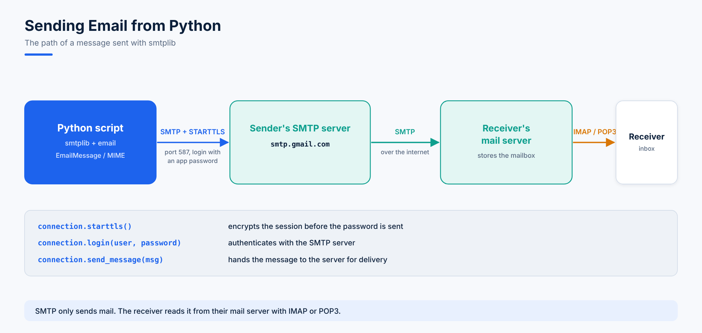

# 27. Sending Emails with smtplib

Automation scripts often need to **alert** someone: a disk is full, a backup failed, a report is ready. Python's built-in **smtplib** sends email through any SMTP server.



## SMTP Servers

| Provider | SMTP server |
|---|---|
| Gmail | `smtp.gmail.com` (port 587) |
| Outlook / Office 365 | `smtp.office365.com` (port 587) |
| Hotmail / Live | `smtp.live.com` |
| Yahoo | `smtp.mail.yahoo.com` |

SMTP sends mail. The receiver reads it from the mail server with **IMAP** or **POP3**.

## Before You Start: a Gmail App Password

Gmail doesn't accept your normal password from scripts. Turn on **2-Step Verification**, then create an **App password** (Google Account > Security > App passwords). It's a 16-character code.

Store it in an environment variable instead of your script:

```bash
export GMAIL_APP_PASSWORD="xxxx xxxx xxxx xxxx"
```

> A password written in a script ends up in Git history, screenshots and shared folders. Read it from the environment (or a secrets manager) every time.

## 1. A Plain Text Email

```python
import os
import smtplib

my_mail = "your.address@gmail.com"
password = os.environ["GMAIL_APP_PASSWORD"]   # never hard-code the password

connection = smtplib.SMTP("smtp.gmail.com", 587)
connection.starttls()                 # TLS: encrypt the connection
connection.login(user=my_mail, password=password)
connection.sendmail(from_addr=my_mail, to_addrs=my_mail, msg="Test mail")
connection.close()
print("Mail has been sent")
```

```console
root@ahmadhassan:~/lect39# python3 mymail.py
Mail has been sent
```

`starttls()` upgrades the connection to **TLS** (Transport Layer Security) before the password is sent.

## 2. Adding a Subject

The raw message needs a `Subject:` header, then a blank line, then the body:

```python
import os
import smtplib

my_mail = "your.address@gmail.com"
password = os.environ["GMAIL_APP_PASSWORD"]   # never hard-code the password

SUBJECT = "CloudOps"
TEXT = "Hi team, this is a test email via the SMTP server"
message = "Subject: {}\n\n{}".format(SUBJECT, TEXT)

connection = smtplib.SMTP("smtp.gmail.com", 587)
connection.starttls()
connection.login(user=my_mail, password=password)
connection.sendmail(from_addr=my_mail, to_addrs=my_mail, msg=message)
connection.close()
print("Mail has been sent")
```

## 3. EmailMessage: the Easy Way

`email.message.EmailMessage` builds headers for you:

```python
import os
import smtplib

my_mail = "your.address@gmail.com"
password = os.environ["GMAIL_APP_PASSWORD"]   # never hard-code the password
from email.message import EmailMessage

msg = EmailMessage()
msg["Subject"] = "This is a test"
msg["From"] = my_mail
msg["To"] = my_mail
msg.set_content("Hi team, we are testing the SMTP server via Python")

connection = smtplib.SMTP("smtp.gmail.com", 587)
connection.starttls()
connection.login(user=my_mail, password=password)
connection.send_message(msg)
connection.close()
print("Mail has been sent")
```

## 4. CC and Attachments

```python
import os
import smtplib

my_mail = "your.address@gmail.com"
password = os.environ["GMAIL_APP_PASSWORD"]   # never hard-code the password
from email.message import EmailMessage

msg = EmailMessage()
msg["Subject"] = "Server report"
msg["From"] = my_mail
msg["To"] = my_mail
msg["Cc"] = ["teammate1@example.com", "teammate2@example.com"]
msg.set_content("Hi team, please find the server report attached")

with open("myfile.csv", "rb") as file:
    attach = file.read()
    file_name = file.name

msg.add_attachment(attach, maintype="application", subtype="octet-stream", filename=file_name)

connection = smtplib.SMTP("smtp.gmail.com", 587)
connection.starttls()
connection.login(user=my_mail, password=password)
connection.send_message(msg)
connection.close()
print("Mail has been sent")
```

## 5. An HTML Body

```python
msg.add_alternative("""
<html>
  <b>Hi Team,<br>We are testing the server via a Python script</b>
</html>
""", subtype="html")
```

## 6. The MIME Way

**MIME** (Multipurpose Internet Mail Extensions) extends email beyond plain ASCII text, so messages can carry other character sets, HTML, images, audio, video and attachments.

- **MIMEMultipart**: a message with several parts (for example text plus HTML plus attachments)
- **MIMEText**: a text or HTML part
- **MIMEBase** + **encoders**: a generic attachment, base64-encoded
- **MIMEImage**: an image, which can be shown inside the HTML body

```python
import os
import smtplib

my_mail = "your.address@gmail.com"
password = os.environ["GMAIL_APP_PASSWORD"]   # never hard-code the password
from email.mime.multipart import MIMEMultipart
from email.mime.text import MIMEText
from email.mime.base import MIMEBase
from email.mime.image import MIMEImage
from email import encoders

filename = "test.txt"
mylogo = "logo.png"

msg = MIMEMultipart()
msg["Subject"] = "My subject"
msg["From"] = my_mail
msg["To"] = my_mail
msg["Cc"] = "teammate@example.com"

body = """
<html><p><b><i>Hi Team,<br> This is a test email via a Python script.</i></b><br>
</p></html>
"""
msg.attach(MIMEText(body, "html"))

# logo shown inside the body (cid:alogo)
with open(mylogo, "rb") as filelogo:
    msg_image = MIMEImage(filelogo.read())
msg_image.add_header("Content-ID", "<alogo>")
msg.attach(msg_image)

# file attachment
with open(filename, "rb") as attachment:
    part = MIMEBase("application", "octet-stream")
    part.set_payload(attachment.read())
encoders.encode_base64(part)
part.add_header("Content-Disposition", f"attachment; filename={os.path.basename(filename)}")
msg.attach(part)

connection = smtplib.SMTP("smtp.gmail.com", 587)
connection.starttls()
connection.login(user=my_mail, password=password)
connection.send_message(msg)
connection.close()
print("Mail has been sent")
```

> Use `os.path.basename()` for the attachment name; otherwise the receiver sees the full local path as the file name.

## 7. Date and Time in the Subject

Alert emails are easier to track when the subject says when they were sent:

```python
# subject_time.py
from datetime import datetime

now = datetime.now()
my_custom = now.strftime("%B %d %Y")
current_time = now.strftime("%I:%M:%S %p")
subject = f"Citrix connection alert {my_custom} {current_time}"
print(subject)
```

```console
root@ahmadhassan:~/lect40# python3 subject_time.py
Citrix connection alert October 19 2026 06:46:48 PM
```

Set `msg["Subject"] = subject` in the MIME example above. Topic 28 sends this email on a schedule, and topic 32 sends it automatically when a server runs low on memory.
