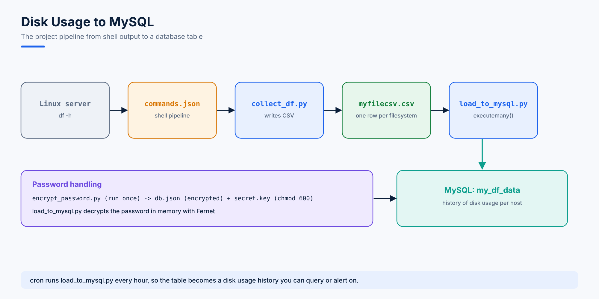

# 36. Project - Disk Usage Reports into MySQL

This project combines most of the course: shell commands from Python, JSON configuration, CSV files, encryption, exception handling and MySQL.

**Goal:** collect `df -h` from a Linux server, save it as a CSV file, and import it into a MySQL table so disk usage can be queried over time.



All the files are in [`projects/disk-usage-to-mysql`](projects/disk-usage-to-mysql).

## Step 1: Build the CSV with Shell Commands

Start with plain `df -h` and refine it one pipe at a time.

Remove `tmpfs` lines and the header:

```console
root@ahmadhassan:~/myproject# df -h | grep -v 'tmpfs' | awk 'NR!=1'
udev                               953M     0  953M   0% /dev
/dev/mapper/ubuntu--vg-ubuntu--lv  8.9G  5.8G  2.7G  69% /
/dev/sda2                          875M  149M  665M  19% /boot
```

Keep the six columns, drop the `%` sign and turn spaces into commas:

```console
root@ahmadhassan:~/myproject# df -h | grep -v 'tmpfs' | awk 'NR!=1' | awk '{print $1,$2,$3,$4,$5,$6}' | sed -e 's/%//g' | sed -E "s/ +/,/g"
udev,953M,0,953M,0,/dev
/dev/mapper/ubuntu--vg-ubuntu--lv,8.9G,5.8G,2.7G,69,/
/dev/sda2,875M,149M,665M,19,/boot
```

Append the date, the IP address and the hostname to every line (`sed "s/$/,..."` adds text at the end of each line):

```console
root@ahmadhassan:~/myproject# df -h | grep -v 'tmpfs' | awk 'NR!=1' | awk '{print $1,$2,$3,$4,$5,$6}' | sed -e 's/%//g' | sed -E "s/ +/,/g" | sed "s/$/,$(date '+%F %T')/g" | sed "s/$/,$(hostname -I | awk '{print $1}')/g" | sed "s/$/,$(hostname)/g"
udev,953M,0,953M,0,/dev,2022-10-02 11:17:51,192.168.1.8,ahmadhassan.local
/dev/mapper/ubuntu--vg-ubuntu--lv,8.9G,5.8G,2.7G,69,/,2022-10-02 11:17:51,192.168.1.8,ahmadhassan.local
/dev/sda2,875M,149M,665M,19,/boot,2022-10-02 11:17:51,192.168.1.8,ahmadhassan.local
```

| Command | Job |
|---|---|
| `grep -v 'tmpfs'` | Drop lines containing `tmpfs` |
| `awk 'NR!=1'` | Drop the first line (the header) |
| `awk '{print $1,...,$6}'` | Keep six columns |
| `sed -e 's/%//g'` | Remove `%` |
| `sed -E "s/ +/,/g"` | Replace runs of spaces with a comma |
| `sed "s/$/,TEXT/g"` | Add `,TEXT` at the end of each line |
| `$(date '+%F %T')` | Current date and time, e.g. `2022-10-02 11:17:51` |
| `$(hostname -I \| awk '{print $1}')` | First IP address |

Detect the OS so the script only runs where it was tested:

```console
root@ahmadhassan:~/myproject# cat /etc/os-release | grep -iw "NAME" | awk -F = '{print $2}' | tr -d '"'
Ubuntu
```

## Step 2: Keep the Commands in JSON

Long shell commands full of quotes are hard to embed in Python. Store them in a JSON file, which also keeps the script readable:

```json
{
    "os_flavour": "cat /etc/os-release | grep -iw \"NAME\" | awk -F = '{print $2}' | tr -d '\"'",
    "df_cmd": "df -h | grep -v 'tmpfs' | awk 'NR!=1' | awk '{print $1,$2,$3,$4,$5,$6}' | sed -e 's/%//g' | sed -E \"s/ +/,/g\" | sed \"s/$/,$(date '+%F %T')/g\" | sed \"s/$/,$(hostname -I | awk '{print $1}')/g\" | sed \"s/$/,$(hostname)/g\" > myfilecsv.csv"
}
```

## Step 3: Generate the CSV from Python

```python
# collect_df.py
#!/usr/bin/python3
"""Run df -h through the commands in commands.json and write myfilecsv.csv."""
import json
import os

SUPPORTED = ("Ubuntu", "CentOS Stream", "Red Hat Enterprise Linux")

try:
    with open("commands.json") as jf:
        commands = json.load(jf)

    os_name = os.popen(commands["os_flavour"]).read().strip()
    if os_name in SUPPORTED:
        os.popen(commands["df_cmd"]).read()
        print("CSV file generated successfully in the current directory")
    else:
        print("Other OS found:", os_name)
except Exception as e:
    print("Something has an issue:", e)
```

```console
root@ahmadhassan:~/myproject# python3 collect_df.py
CSV file generated successfully in the current directory
root@ahmadhassan:~/myproject# cat myfilecsv.csv
udev,953M,0,953M,0,/dev,2022-10-02 13:47:10,192.168.1.8,ahmadhassan.local
/dev/mapper/ubuntu--vg-ubuntu--lv,8.9G,5.8G,2.7G,69,/,2022-10-02 13:47:10,192.168.1.8,ahmadhassan.local
/dev/sda2,875M,149M,665M,19,/boot,2022-10-02 13:47:10,192.168.1.8,ahmadhassan.local
```

## Step 4: Create the Table

```sql
mysql> use cloudops;
mysql>
create table my_df_data
(
file_id int NOT NULL AUTO_INCREMENT,
filesystem varchar(255),
size varchar(255),
used varchar(255),
avail varchar(255),
usage_with_per int,
mounted_on varchar(255),
datetime datetime,
ip_address varchar(255),
hostname varchar(255),
PRIMARY KEY (file_id)
);
Query OK, 0 rows affected (0.02 sec)
```

## Step 5: Keep the Password Encrypted

The database password must not sit in plain text in the script or the JSON file. The **cryptography** package's **Fernet** gives simple symmetric encryption: one key encrypts and decrypts.

See how it works:

```python
# fernet_demo.py
from cryptography.fernet import Fernet

key = Fernet.generate_key()
f = Fernet(key)

token = f.encrypt("my-database-password".encode("utf-8"))
print(token[:40], "...")
print(f.decrypt(token).decode("utf-8"))
```

```console
root@ahmadhassan:~/myproject# python3 fernet_demo.py
b'gAAAAABq1h7t2tIEbFyVcHtoUxmqhTe5eKnAc2S7' ...
my-database-password
```

Encrypting and then decrypting in the same script protects nothing, because the key travels with the data. Do it in two steps:

1. Run `encrypt_password.py` **once**. It saves the key in `secret.key` and the encrypted password in `db.json`.
2. `load_to_mysql.py` reads both and decrypts the password only in memory.

Keep `secret.key` readable only by the script's user (`chmod 600 secret.key`) and out of Git (it's in the project's `.gitignore`).

```python
# encrypt_password.py
"""Run once: encrypt the MySQL password and save it with its key."""
import getpass
import json
import os
from cryptography.fernet import Fernet

key = Fernet.generate_key()
with open("secret.key", "wb") as kf:
    kf.write(key)
os.chmod("secret.key", 0o600)

password = getpass.getpass("MySQL password for mysql_user: ")
token = Fernet(key).encrypt(password.encode("utf-8")).decode("utf-8")

config = {"host": "192.168.1.8", "user": "mysql_user", "password": token, "database": "cloudops"}
with open("db.json", "w") as jf:
    json.dump(config, jf, indent=4)

print("Saved db.json and secret.key")
```

```console
root@ahmadhassan:~/myproject# python3 encrypt_password.py
MySQL password for mysql_user:
Saved db.json and secret.key
```

`getpass` reads the password without showing it on screen.

## Step 6: Import the CSV into MySQL

```python
# load_to_mysql.py
#!/usr/bin/python3
"""Generate myfilecsv.csv, then import it into the my_df_data table."""
import csv
import json
import os
import mysql.connector
from cryptography.fernet import Fernet

try:
    print("Running collect_df.py to create the CSV file...")
    os.system("python3 collect_df.py")

    print("Reading the MySQL settings and decrypting the password...")
    with open("secret.key", "rb") as kf:
        key = kf.read()
    with open("db.json") as jf:
        db = json.load(jf)
    password = Fernet(key).decrypt(db["password"].encode("utf-8")).decode("utf-8")

    mydb = mysql.connector.connect(host=db["host"], user=db["user"],
                                   password=password, database=db["database"])

    print("Reading the CSV file and storing it in MySQL...")
    with open("myfilecsv.csv") as csv_file:
        all_values = [tuple(row[:9]) for row in csv.reader(csv_file)]

    query = ("insert into my_df_data (filesystem,size,used,avail,usage_with_per,"
             "mounted_on,datetime,ip_address,hostname) "
             "values (%s,%s,%s,%s,%s,%s,%s,%s,%s)")
    cursor = mydb.cursor()
    cursor.executemany(query, all_values)
    mydb.commit()
    print(cursor.rowcount, "rows imported into the database successfully")
    mydb.close()
except Exception as e:
    print("Something has an issue:", e)
```

```console
root@ahmadhassan:~/myproject# python3 load_to_mysql.py
Running collect_df.py to create the CSV file...
CSV file generated successfully in the current directory
Reading the MySQL settings and decrypting the password...
Reading the CSV file and storing it in MySQL...
3 rows imported into the database successfully
```

`executemany()` inserts all rows in one call. Every value goes through `%s` placeholders, so nothing can break the SQL (topic 35).

## Step 7: Query the Results

```sql
mysql> select * from my_df_data;
+---------+-----------------------------------+------+------+-------+----------------+------------+---------------------+-------------+-------------------+
| file_id | filesystem                        | size | used | avail | usage_with_per | mounted_on | datetime            | ip_address  | hostname          |
+---------+-----------------------------------+------+------+-------+----------------+------------+---------------------+-------------+-------------------+
|       1 | udev                              | 953M | 0    | 953M  |              0 | /dev       | 2022-10-02 11:46:24 | 192.168.1.8 | ahmadhassan.local |
|       2 | /dev/mapper/ubuntu--vg-ubuntu--lv | 8.9G | 5.8G | 2.7G  |             69 | /          | 2022-10-02 11:46:24 | 192.168.1.8 | ahmadhassan.local |
|       3 | /dev/sda2                         | 875M | 149M | 665M  |             19 | /boot      | 2022-10-02 11:46:24 | 192.168.1.8 | ahmadhassan.local |
+---------+-----------------------------------+------+------+-------+----------------+------------+---------------------+-------------+-------------------+
3 rows in set (0.00 sec)

mysql> select * from my_df_data where usage_with_per >= 50 and ip_address='192.168.1.8';
+---------+-----------------------------------+------+------+-------+----------------+------------+---------------------+-------------+-------------------+
| file_id | filesystem                        | size | used | avail | usage_with_per | mounted_on | datetime            | ip_address  | hostname          |
+---------+-----------------------------------+------+------+-------+----------------+------------+---------------------+-------------+-------------------+
|       2 | /dev/mapper/ubuntu--vg-ubuntu--lv | 8.9G | 5.8G | 2.7G  |             69 | /          | 2022-10-02 11:46:24 | 192.168.1.8 | ahmadhassan.local |
|       5 | /dev/mapper/ubuntu--vg-ubuntu--lv | 8.9G | 5.8G | 2.7G  |             69 | /          | 2022-10-02 13:37:28 | 192.168.1.8 | ahmadhassan.local |
+---------+-----------------------------------+------+------+-------+----------------+------------+---------------------+-------------+-------------------+
2 rows in set (0.00 sec)

mysql> select * from my_df_data where usage_with_per >= 50 and ip_address='192.168.1.6';
Empty set (0.00 sec)
```

## Step 8: Run It Every Day

```text
0 * * * * cd /root/myproject && /usr/bin/python3 load_to_mysql.py >> load.log 2>&1
```

Every hour cron collects new rows, and the table becomes a history of disk usage you can graph or alert on.

---

## Task

Extend the project to store memory details too. `free -gt` shows totals:

```console
root@ahmadhassan:~/myproject# free -gt
              total        used        free      shared  buff/cache   available
Mem:              1           0           1           0           0           1
Swap:             1           0           1
Total:            3           0           2
```

Create a `my_memory_data` table, add a `mem_cmd` to `commands.json` that turns the `Mem:` line into CSV, and import it the same way.
